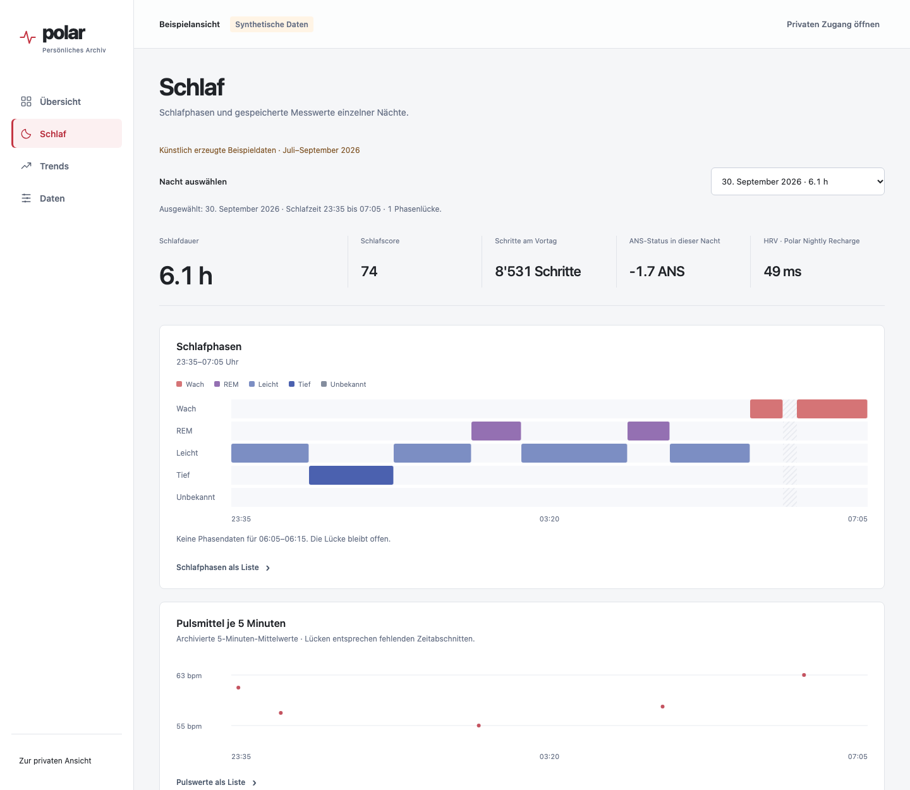
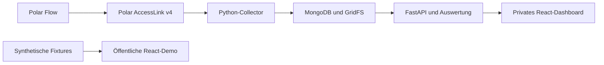

# Polar Health Analytics

Eine Fullstack-Anwendung, die Polar-Messungen in persönliche Verläufe, interaktive Nachtansichten und nachvollziehbare Bewegungsvergleiche übersetzt. Entwickelt mit React, TypeScript, Python, FastAPI und MongoDB.

[Öffentliche Demo](https://polarhealth.onrender.com/demo) · [Direkt zum Nachtverlauf](https://polarhealth.onrender.com/demo#nachtansicht) · [Privates Dashboard](https://polarhealth.onrender.com/)



*Die öffentliche Demo und die Abbildung verwenden künstlich erzeugte Daten. Persönliche Messungen sind über den Besitzerzugang erreichbar.*

## Das Projekt

Wie hängen die Bewegung eines Tages und die folgende Nacht zusammen? Welche Schlafphasen wurden aufgezeichnet? Wie unterscheiden sich einzelne Tage vom eigenen bisherigen Verlauf?

Polar Health Analytics verbindet diese Fragen mit einem überprüfbaren Datenfluss. Originalantworten werden vor der Auswertung archiviert. Daraus entstehen Tageswerte und Nachtverläufe, bei denen Messdatum, Datenlücken und Herkunft sichtbar bleiben.

Das Projekt umfasst die Verarbeitung vom serverseitigen OAuth-Zugang über die Datensammlung und Archivierung bis zur interaktiven Darstellung im Browser.

## Funktionen

Die Oberfläche ist in vier feste Bereiche gegliedert. Öffentliche Demo und privates Archiv verwenden dieselbe Navigation und dieselben Ansichten.

| Bereich | Inhalt |
| --- | --- |
| **Übersicht** | Tageswerte mit gemeinsamem Messdatum, offizielle Polar-Erholung und Schlafverlauf |
| **Schlaf** | Einzelne Nächte, getrennte Schlafphasenspuren und Pulsmittelwerte |
| **Trends** | Zeitreihen über 7/30/90 Tage und Bewegungsvergleiche im Recovery Lab |
| **Daten** | Polar-Verbindung, Abrufstatus, Datenquellen und Originalantworten |


### Night Explorer

Eine Nacht auswählen und ihren Verlauf erkunden.

- Getrennte, beschriftete Zeitspuren für Wach-, Leicht-, Tief- und REM-Schlaf sowie unbekannte Abschnitte.
- Schlafdauer in Stunden, Polar-Schlafscore, Schritte des Vortags, ANS-Status und HRV aus Polar Nightly Recharge.
- Pulsmittelwerte in Fünf-Minuten-Zeitabschnitten innerhalb der gespeicherten Schlafgrenzen.
- Aufklappbare Listen mit Uhrzeiten und Werten sowie eine per Tastatur bedienbare Nachtauswahl.
- Zeitliche Ausrichtung über Mitternacht und die Zürcher Sommer-/Winterzeit hinweg. Einzelne bekannte Schlafgrenzen bleiben auch bei unvollständigen Angaben sichtbar.

Die private Ansicht lädt archivierte Nächte aus den letzten 90 Kalendertagen beim Öffnen des Bereichs „Schlaf“. Die öffentliche Demo bietet vier synthetische Beispielnächte.

### Recovery Lab

Das Recovery Lab vergleicht Schritte an einem Tag mit Schlafdauer oder ANS-Status in der folgenden Kalendernacht.

- Auswahl zwischen 30 und 90 Tagen sowie Schlafdauer und ANS-Status.
- Aufteilung der Bewegungstage anhand des persönlichen Schrittmedians.
- Gruppenmediane und Quartile ab mindestens sieben vollständigen Paaren **je Gruppe**.
- Auswählbare Punkte und getrennte Angaben zu fehlenden oder vorläufigen Messungen.

Die synthetischen Vergleichsdaten entstehen mit derselben Berechnungsfunktion wie die private Auswertung.

### Verläufe und Datenherkunft

- Tagesreihen für Schlafdauer, Herzfrequenz, ANS, Schritte und Trainingsdauer über 7, 30 oder 90 Tage.
- Persönlicher Vergleich mit dem Median der vorherigen 28 Kalendertage, sobald mindestens sieben gültige, abgeschlossene Vergleichstage vorliegen.
- Dateninspektor mit Abrufzeit, HTTP-Status, Parametern, SHA-256-Hash und gespeicherter Originalantwort.
- Ladeanzeige mit verstrichener Wartezeit während des Verbindungsaufbaus und des ersten Dashboard-Abrufs.

## Architektur



| Bereich | Umsetzung |
| --- | --- |
| Oberfläche | React, TypeScript, Vite, CSS und SVG |
| Backend | Python 3.12 und FastAPI |
| Polar-Anbindung | AccessLink v4, serverseitiges OAuth 2.0, HTTPX |
| Speicherung | MongoDB und GridFS |
| Tests | pytest, mongomock, Vitest und React Testing Library |
| Deployment | Gemeinsamer Frontend-/Backend-Dienst auf Render, MongoDB Atlas |

Der Collector liest 19 ausgewählte Datenbereiche. Er archiviert empfangene Antwortbytes vor dem Parsing und hält Herkunft sowie Abrufverlauf fest. Identische Antwortkörper können denselben Speicher verwenden, während einzelne Abrufe nachvollziehbar bleiben. Die Auswertung führt wiederholte und korrigierte Messungen anhand ihrer archivierten Versionen zusammen.

Sitzungen, verschlüsselte Polar-Tokens und die Sperre für gleichzeitige Abrufe liegen in MongoDB. Ein beendeter oder abgelaufener, unterbrochener Lauf kann beim nächsten authentifizierten Öffnen erneut gestartet werden. Nach abgeschlossenen automatischen Abrufen gilt eine Wartezeit von 15 Minuten.

## Öffentliche Demo lokal starten

Voraussetzung ist Node.js 22 mit npm. Alle Befehle im Projektverzeichnis ausführen.

```sh
npm --prefix apps/web ci
npm --prefix apps/web run dev
```

Anschließend `/demo` an der vom Entwicklungsserver ausgegebenen Adresse öffnen, üblicherweise [127.0.0.1:5173/demo](http://127.0.0.1:5173/demo).

Die Demo arbeitet mit gebündelten Fixtures im Browser. Dafür werden weder eine Polar-Verbindung noch eine Datenbank benötigt. Der feste Beispielzeitraum reicht vom 3. Juli bis zum 30. September 2026, die vier Beispielnächte liegen am Ende dieses Zeitraums.

## Privaten Betrieb lokal einrichten

Benötigt werden Python 3.12, Node.js 22, eine MongoDB-Datenbank und ein Polar-AccessLink-Client.

```sh
python3.12 -m venv .venv
.venv/bin/python -m pip install -r requirements.lock
.venv/bin/python scripts/setup_local.py
npm --prefix apps/web ci
npm --prefix apps/web run build
```

Das Einrichtungsskript erstellt die ignorierte `.env` aus `.env.example` und ergänzt fehlende lokale Zugangsschlüssel. Folgende Werte für die eigene Umgebung setzen.

| Variable | Zweck |
| --- | --- |
| `POLAR_CLIENT_ID`, `POLAR_CLIENT_SECRET` | Zugangsdaten des Polar-Clients |
| `MONGODB_URI`, `MONGODB_DATABASE` | Verbindung und Name der Archivdatenbank |
| `APP_ORIGIN` | Lokal `http://127.0.0.1:5000` |
| `POLAR_REDIRECT_URI` | Lokal `http://127.0.0.1:5000/oauth2_callback`, auch beim Polar-Client registrieren |
| `OWNER_PASSWORD` | Passwort für den privaten Besitzerzugang |
| `SESSION_SECRET` | Signierung der Sitzung |
| `TOKEN_ENCRYPTION_KEY` | Fernet-Schlüssel für gespeicherte Polar-Tokens |

Danach das Backend starten.

```sh
PYTHONPATH=apps/api .venv/bin/uvicorn polar_api.app:create_app --factory --host 127.0.0.1 --port 5000 --no-access-log
```

[127.0.0.1:5000](http://127.0.0.1:5000) öffnen, mit dem lokal hinterlegten Besitzerpasswort anmelden und über „Mit Polar verbinden“ den OAuth-Ablauf abschließen. Der Datenabruf startet beim authentifizierten Öffnen des verbundenen Dashboards und lässt sich über „Aktualisieren“ erneut anstoßen.

Die vollständige Einrichtung und das Render-Deployment stehen in [RUNNING.md](docs/RUNNING.md). `render.yaml` enthält die Deployment-Konfiguration für `main`. Geheime Werte werden in der jeweiligen Laufzeitumgebung gesetzt.

## Tests

```sh
PYTHONPATH=apps/api .venv/bin/python -m pytest tests
npm --prefix apps/web test
npm --prefix apps/web run build
```

Die Tests verwenden simulierte MongoDB- und Polar-Antworten. Sie prüfen unter anderem Zugriffsrechte, Abrufsperren und Wiederholungen, Archivierung, Korrekturen, Zeitumstellungen, fehlende Messungen, Mindesthistorie, Nachtwechsel und die Trennung zwischen öffentlicher Demo und privaten Daten.

## Einordnung der Auswertungen

Die angezeigten Zusammenhänge beschreiben Beobachtungen aus einem persönlichen Archiv. Sie erlauben keine Aussage über Ursachen oder medizinische Diagnosen. Schlafscore und ANS stammen aus den jeweiligen Polar-Feldern.

Fehlende Werte bleiben als Lücken oder „Nicht verfügbar“ erkennbar. Ein tatsächlich gemessener Nullwert wird dort erhalten, wo der Messwert ihn zulässt. Tagesstände können vorläufig sein. Schlafdauer wird in Stunden und Minuten angezeigt; Diagrammachsen verwenden Stunden. Die zugrunde liegenden API-Werte bleiben in Minuten.

Ein Zeitraum von 90 Tagen zeigt die dafür vorhandenen Archivmessungen. Der Collector fragt aktuell ein rollierendes Fenster ab, das sieben vergangene Kalendertage und den laufenden Tag umfasst. Eine regelmäßige Hintergrundplanung und eine automatische historische Nachladung sind bislang nicht eingerichtet. Der kostenlose Render-Dienst kann beim ersten Aufruf Anlaufzeit benötigen.

## Weiterführende Dokumentation

- [Lokale Einrichtung und Deployment](docs/RUNNING.md)
- [Auswertungsmethoden und Tagesvergleiche](docs/ANALYTICS.md)
- [Polar-API-Verträge und beobachtete Antwortformate](docs/API_CONTRACTS.md)
- [Dateninventar](docs/DATA_INVENTORY.md)
- [Archivpflege und Sicherung](docs/ARCHIVE_MAINTENANCE.md)

Private Zugangsdaten, Tokens, Gesundheitsdaten und lokale Ausgaben gehören in die dafür vorgesehenen privaten Speicher. Die versionierten Demodaten und die Abbildung sind synthetisch.
